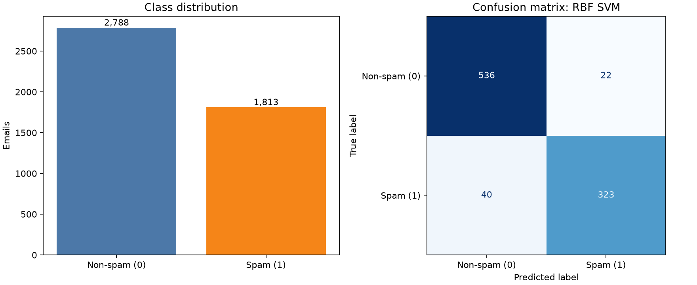

# 04 作业：使用 SVM 进行垃圾邮件分类

## 一、作业目标

使用课件介绍的支持向量机（SVM）算法，对公开数据集进行二分类，完成数据检查、模型训练、参数选择和效果分析。

课件在“真实数据分析案例”部分介绍了 Spambase 垃圾邮件数据，并建议比较线性核与 RBF 核。因此本次选用 UCI Machine Learning Repository 的 Spambase 数据集。

## 二、数据集说明

- 数据来源： [UCI Spambase 数据集](https://archive.ics.uci.edu/dataset/94/spambase)
- 原始数据文件：[`data/spambase.data`](data/spambase.data)
- 字段说明：[`data/spambase.names`](data/spambase.names)；数据集说明：[`data/spambase.DOCUMENTATION`](data/spambase.DOCUMENTATION)
- 数据规模：4,601 封邮件、57 个数值特征和 1 个二分类标签。
- 标签含义：`spam=1` 表示垃圾邮件，`spam=0` 表示非垃圾邮件。
- 特征包括邮件中指定单词、字符的出现比例，以及连续大写字母序列的统计量；数据不含邮件正文。
- 原始数据中垃圾邮件 1,813 封，非垃圾邮件 2,788 封。类别比例不完全相同，因此报告垃圾邮件类别的精确率、召回率和 F1，不只看准确率。
- 数据集由 UCI 页面注明采用 CC BY 4.0；本作业保留数据文件及来源信息，并在此注明出处。引用：Hopkins, M., Reeber, E., Forman, G., & Suermondt, J. (1999). *Spambase*. UCI Machine Learning Repository. <https://doi.org/10.24432/C53G6X>。

## 三、分析方法

1. 检查数据形状、缺失值、标签类别和重复记录。
2. 将标签 `1` 作为关注的正类（垃圾邮件），使用分层分组的五折划分，留出一折作为测试集，其余四折用于训练。完全相同的 57 维特征向量作为同一组，避免重复特征同时进入训练集和测试集。
3. 在线性 SVM 和 RBF 核 SVM 前使用 `StandardScaler` 标准化。标准化位于 `Pipeline` 内，因此每个交叉验证折只根据该折训练部分计算缩放参数。
4. 在训练集上用分层分组五折交叉验证和网格搜索选择 `C`；RBF 模型同时搜索 `gamma`。选择标准为垃圾邮件 F1。
5. 将调好参数的线性 SVM、RBF SVM 和多数类基线在独立测试集上比较，最终模型按训练集交叉验证 F1 选出。测试集只用于最后评估。

本流程借鉴了 scikit-learn 对 [`SVC`](https://scikit-learn.org/stable/modules/generated/sklearn.svm.SVC.html)、[`Pipeline`](https://scikit-learn.org/stable/modules/generated/sklearn.pipeline.Pipeline.html) 和 [`GridSearchCV`](https://scikit-learn.org/stable/modules/generated/sklearn.model_selection.GridSearchCV.html) 的官方用法。SVM 对特征尺度敏感，所以标准化与模型放入同一条 Pipeline。

## 四、运行方式

在仓库根目录运行：

```powershell
.\.venv\Scripts\python.exe 04作业\svm_spambase.py
```

依赖见仓库根目录 `requirements.txt`。脚本读取本目录下的 UCI 原始数据，完成交叉验证与测试，并在 `results/` 下生成测试集指标、交叉验证结果、混淆矩阵 CSV 和结果图；不需要再次联网下载数据。

## 五、运行结果

运行环境：Python 3.12.4、scikit-learn 1.9.1、pandas 3.0.6。固定随机种子为 `42`。

### 数据检查与划分

- 数据共 4,601 行、57 个特征，无缺失值；非垃圾邮件 2,788 封，垃圾邮件 1,813 封。
- 发现 391 条完整重复记录、394 条重复特征行；有 3 组完全相同的特征向量对应了不同标签。
- 使用分层分组五折得到 3,680 行训练数据和 921 行测试数据。相同特征向量不会跨训练集、测试集或交叉验证折。

### 测试集表现

| 模型 | 训练集交叉验证最佳 F1 | 准确率 | 垃圾邮件精确率 | 垃圾邮件召回率 | 垃圾邮件 F1 | ROC-AUC | PR-AUC（Average Precision） |
|---|---:|---:|---:|---:|---:|---:|---:|
| 多数类基线 | — | 0.6059 | 0.0000 | 0.0000 | 0.0000 | 0.5000 | 0.3941 |
| 线性 SVM | 0.8979 | 0.9240 | 0.9127 | 0.8926 | 0.9025 | 0.9665 | 0.9335 |
| RBF SVM | **0.9180** | **0.9327** | **0.9362** | 0.8898 | **0.9124** | **0.9754** | **0.9596** |

按训练交叉验证的垃圾邮件 F1 选择 RBF SVM，最优参数为 `C=100`、`gamma=0.001`。模型支持向量数为 730。



所选 RBF 模型测试集混淆矩阵（行是真实类别，列是预测类别；顺序为非垃圾邮件、垃圾邮件）：

|  | 预测非垃圾邮件 | 预测垃圾邮件 |
|---|---:|---:|
| 实际非垃圾邮件 | 536 | 22 |
| 实际垃圾邮件 | 40 | 323 |

## 六、结果讨论

SVM 明显优于多数类基线。RBF SVM 的垃圾邮件 F1 为 0.9124，高于线性 SVM 的 0.9025；其精确率较高（0.9362），召回率略低（0.8898）。也就是说，在这 363 封真实垃圾邮件中，模型找出 323 封、漏掉 40 封；在 558 封真实非垃圾邮件中，误报 22 封。

线性 SVM 的召回率略高于 RBF，而 RBF 的精确率更高，说明选型取决于漏报和误报的业务代价。RBF 的交叉验证与测试集 F1 均较好，但这只是当前数据划分下的比较。`C` 控制对分类错误的惩罚，`gamma` 控制 RBF 核影响范围；参数由训练集交叉验证选择，没有使用测试集调参。

## 七、结论与局限

本实验用标准化、交叉验证和独立测试集完成了 SVM 二分类，并通过多数类基线及两种核函数进行比较。Spambase 于 1999 年捐赠，特征含有数据采集时期和来源的痕迹；因此结果只支持对该公开数据集的判断，不能直接代表现代邮件。部署到真实邮箱前，应使用近期、具有代表性的邮件样本重新验证，并按误报、漏报成本选择阈值。
